# Praktikum 5 - JavaScript Dasar dan Manipulasi HTML 

## Nama: Fadhil Syafiq Abdullah 
## NIM: 312510161   
## Mata Kuliah: Pemrograman Web   

### Langkah 1 — Membuat Struktur File 

Membuat folder Lab5Web yang berisi file index.html dan script.js. 

### Langkah 2 — Menghubungkan JavaScript 

Menghubungkan file JavaScript dengan HTML menggunakan elemen <script>. 

### Langkah 3 — Menampilkan Output 

Menguji textContent dan console.log() untuk menampilkan pesan. 

### Langkah 4 — Dialog Browser 

Menggunakan prompt() untuk menerima input dan alert() untuk menampilkan pesan. 

### Langkah 5 — Operasi Aritmetika 

Membuat function untuk menjalankan operasi dasar matematika. 

### Langkah 6 — Percabangan 

Menerapkan if–else dan switch untuk menentukan hasil berdasarkan kondisi. 

### Langkah 7 — Bilangan Genap dan Ganjil 

Membuat form untuk memeriksa jenis bilangan yang dimasukkan. 

### Langkah 8 — Mengubah Warna Halaman 

Membuat tombol untuk mengubah warna latar menggunakan JavaScript. 

### Langkah 9 — Manipulasi DOM 

Menggunakan checkbox untuk memilih menu dan menghitung total harga secara otomatis. 

### Langkah 10 — Mini Project 

Membuat kalkulator nilai mahasiswa untuk menentukan nilai akhir, predikat, dan kelulusan. 

### Langkah 11 — Pengujian dan Dokumentasi 

Menjalankan program, menguji hasilnya, serta mengambil screenshot kode dan output. 

### Struktur HTML dan JavaScript 

.png) 

Screenshot ini menunjukkan struktur awal halaman HTML dan hubungan antara file HTML dengan JavaScript eksternal. Elemen HTML digunakan sebagai tempat menampilkan konten, sedangkan JavaScript digunakan untuk mengatur perilaku halaman. 

### Menampilkan Output 

.png) 

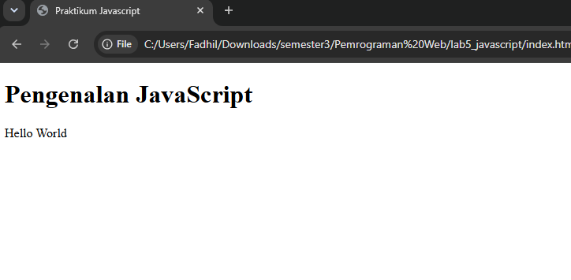 

Kode ini menggunakan textContent dan console.log() untuk menampilkan pesan Hello World. textContent mengubah teks pada elemen HTML, sedangkan console.log() menampilkan pesan pada Console browser. 

### Alert dan Prompt 

.png) 

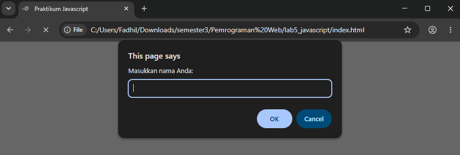 

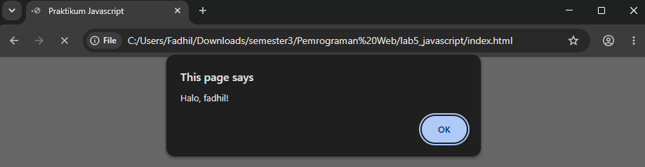

 

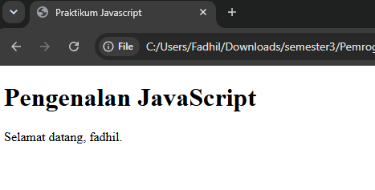 

Kode ini menggunakan prompt() untuk meminta nama pengguna dan alert() untuk memberikan pesan. Program juga memeriksa apakah nama telah diisi sebelum menampilkan pesan selamat datang. 

### Function dan Operasi Aritmatika 

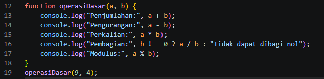 

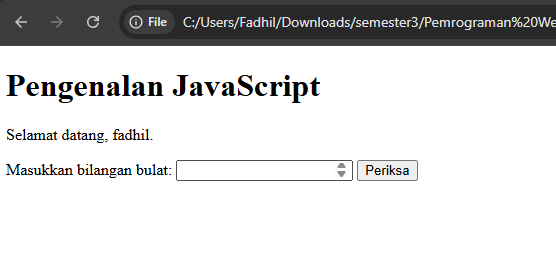 

.png>) 

Kode ini menggunakan function untuk menjalankan operasi aritmetika pada dua bilangan. Operasi yang dilakukan meliputi penjumlahan, pengurangan, perkalian, pembagian, dan modulus. Program juga memeriksa pembagian dengan nol agar tidak menghasilkan operasi pembagian yang tidak valid. 

### Percabangan if-Else 

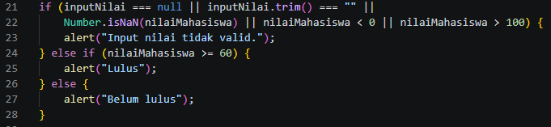 

Kode ini menerima input nilai mahasiswa, mengubah input menjadi tipe numerik, dan memvalidasi rentang nilai 0–100. Jika nilai minimal 60, mahasiswa dinyatakan lulus. Jika nilainya kurang dari 60, mahasiswa dinyatakan belum lulus. 

### Percabangan Switch 

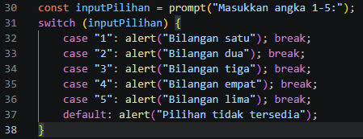 

Kode ini menggunakan switch untuk memeriksa pilihan angka 1 sampai 5. Setiap pilihan menampilkan nama bilangan melalui dialog alert(). Apabila pilihan tidak sesuai, program menampilkan pesan bahwa pilihan tidak tersedia. 

### Form Bilangan Genap atau Ganjil 

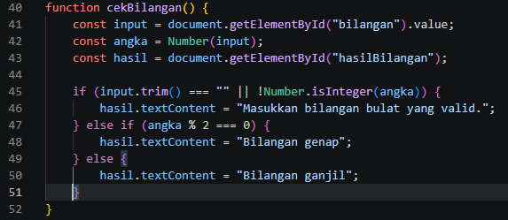 

.png) 

.png) 

Kode ini mengambil input dari form HTML, kemudian memeriksa apakah input merupakan bilangan bulat yang valid. Operator modulus (%) digunakan untuk menentukan apakah bilangan termasuk genap atau ganjil. 

### Mengubah Warna Latar Halaman 

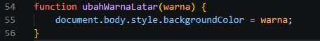 

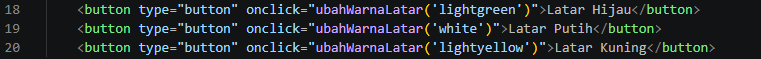 

.png) 

.png) 

.png) 

Kode ini menggunakan function ubahWarnaLatar(warna) untuk mengubah warna latar halaman. Parameter warna memungkinkan satu function digunakan oleh beberapa tombol dengan warna yang berbeda. 

### Checkbox Menu Makanan 

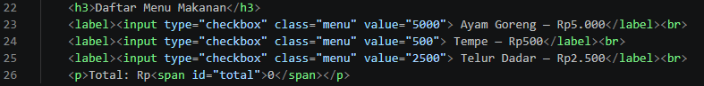 

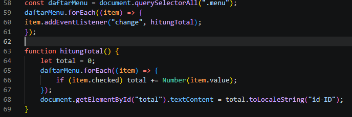 

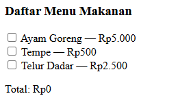 

Kode ini menggunakan checkbox untuk memilih menu makanan dan addEventListener() untuk mendeteksi perubahan pilihan. Program menjumlahkan harga menu yang dipilih dan memperbarui total harga pada halaman HTML. 